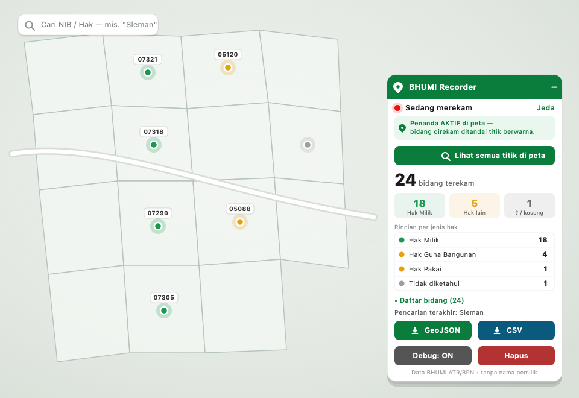
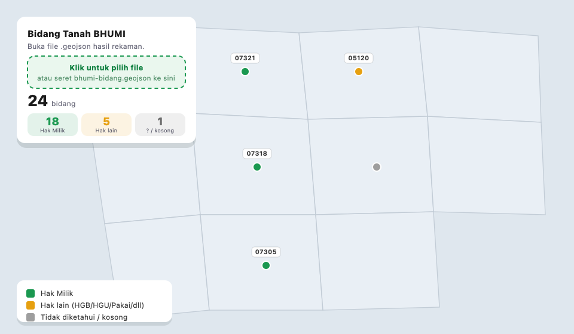

# BHUMI Recorder

Record land parcels and land-right types from [BHUMI ATR/BPN](https://bhumi.atrbpn.go.id/peta), directly in your browser without a recording server.

Click parcels normally. The tool records their information, adds coloured map markers, counts parcels by right type, and exports GeoJSON and CSV.

English documentation for the `julien355/bhumi-recorder` fork of [mhrdwan/bhumi-recorder](https://github.com/mhrdwan/bhumi-recorder). Original authorship and MIT licence must be retained. [Original Indonesian documentation](README.id.md). This translation does not change the program or translate its interface.

## What is it for?

BHUMI displays registered parcels and their land-right types when you select them. BHUMI Recorder helps collect that information while you browse manually:

- **Count parcels:** see totals for Hak Milik, Hak Guna Bangunan, Hak Pakai and other right types, ranked by count.
- **Track inspected parcels:** coloured point markers show what you have already clicked: green for Hak Milik, orange for other rights, grey for unknown status.
- **Save results:** export GeoJSON for mapping and CSV for spreadsheets, including NIB, right type, area, land use, coordinates and search terms where available.
- **View saved results:** open `viewer.html` and load the exported GeoJSON.

Useful for personal land research and preliminary site screening. You browse manually; the recorder collects information in the background.

## Main features

| Feature | Description |
|---|---|
| Map markers | Coloured points remain attached to their map locations during pan and zoom. |
| Right-type breakdown | Counts appear directly in the recorder panel. |
| Parcel list | NIB and right type; click a row to navigate to its location. |
| Duplicate prevention | Records are deduplicated by NIB. |
| Ignore records without NIB | Only selections returning a NIB are recorded. |
| Search history | The current search term is saved with each record. |
| Export | Download GeoJSON and CSV from the panel. |
| Local viewer | View saved data without running a server. |
| Local storage | Recorded data is stored in the browser's localStorage. |

## Screenshots

Recorder panel, shown at the bottom right of BHUMI:



Local viewer, after loading an exported GeoJSON file:



These upstream illustrations use example data. Their embedded labels remain in Indonesian.

## Important limitations

1. **Owner names are not provided.** The tool records land-right types, not the owner's identity.
2. **Coverage is incomplete.** Unregistered or unmapped parcels may have no information. A missing record does not establish that land is vacant or unowned.
3. **This is spatial information, not legal verification.** The upstream project advises official checks through SKPT, the BPN office or a PPAT before a land purchase.

### Polygon and Google Earth clarification

The current recorder exports GeoJSON and CSV, not KML or KMZ directly. It preserves geometry supplied by the source, but may record only a point or no geometry. Check for `Polygon` or `MultiPolygon` before expecting parcel boundaries. Converting a point to KML does not create a boundary.

In version 1.5.0, merging duplicate records prefers existing geometry. A previously recorded point can therefore remain even if richer geometry arrives later. This documentation translation does not fix that behaviour.

The upstream README describes the viewer as offline. Treat this as local-file use: external map tiles or libraries may still require connectivity. The browser also contacts BHUMI during normal browsing; local recording does not mean the whole browsing session is offline.

## Installation

### Install Tampermonkey

Install the extension from your browser's official store:

- [Chrome / Edge / Brave](https://chromewebstore.google.com/detail/tampermonkey/dhdgffkkebhmkfjojejmpbldmpobfkfo)
- [Firefox](https://addons.mozilla.org/firefox/addon/tampermonkey/)

### Add the recorder script

1. Click the Tampermonkey icon and choose **Create a new script**.
2. Remove the example code.
3. Open [`bhumi-recorder.user.js`](bhumi-recorder.user.js), copy its complete contents and paste them into the editor.
4. Choose **File  Save**, or press **Ctrl+S / Cmd+S**.
5. Open or reload BHUMI. The script is configured to run on `bhumi.atrbpn.go.id`.

Alternatively, open the [upstream installation link](https://raw.githubusercontent.com/mhrdwan/bhumi-recorder/main/bhumi-recorder.user.js); Tampermonkey should offer to install it.

**Update source:** the copied upstream script still points its automatic update URLs to `mhrdwan/bhumi-recorder`. Installing it uses upstream updates. Those URLs must be deliberately changed before distributing a separately maintained fork version.

## Usage

1. Open [BHUMI](https://bhumi.atrbpn.go.id/peta).
2. Enable **Tambah Data  Bidang Tanah** (Add Data  Land Parcels). Read the disclaimer and accept it if you agree.
3. Look for the green **BHUMI Recorder** panel at the bottom right. Refresh if it does not appear.
4. Click a parcel. When NIB/right-type/area information is returned, the recorder count should increase and a coloured marker should appear.
5. Search for a location or NIB/HAK reference and click the parcels you want to record.
6. Click **GeoJSON** and **CSV** to download results, normally into Downloads.

The panel also contains a right-type breakdown and parcel list. Original interface labels:

| Indonesian | English |
|---|---|
| Lihat semua titik | Show all points |
| Jeda / Lanjut | Pause / Resume |
| Hapus | Clear / Delete |
| Tidak diketahui | Unknown |
| Menyiapkan penanda peta. | Preparing map markers. |
| Tampilkan label NIB | Show NIB labels |

### First run: debug mode

The script initially enables debugging because BHUMI's data structure can change. Open the browser Console with **F12** and look for green `[BHUMI-REC]` entries after clicking a parcel. If counts do not increase or labels look wrong, inspect those messages to diagnose field mapping. Turn **Debug: OFF** after checking the results. Review logs for sensitive information before sharing them.

## View exported results

- **Local viewer:** open [`viewer.html`](viewer.html), then drag `bhumi-bidang.geojson` into it. Click records to inspect details and enable **Tampilkan label NIB** to display parcel identifiers.
- **Web viewer:** open [geojson.io](https://geojson.io) and load the exported GeoJSON if you are comfortable using that external site.
- **Spreadsheet:** open `bhumi-bidang.csv` in Excel, Numbers or Google Sheets.

## Exported fields

Field names and Indonesian category values remain unchanged for compatibility.

| Field | Meaning |
|---|---|
| `nib` | Nomor Identifikasi Bidang: parcel identification number |
| `tipe_hak` | Original land-right type, such as Hak Milik or Hak Guna Bangunan |
| `kategori` | Hak Milik / Hak lain (other rights) / Tidak diketahui (unknown) |
| `is_hak_milik` | Boolean indicating the Hak Milik classification |
| `penggunaan` | Land use, if available |
| `luas` | Reported area, if available |
| `lon`, `lat` | Representative coordinates; code assumes EPSG:4326 |
| `search_term` | Search term active when the parcel was recorded |
| `source` | Source marker, such as peta (map), panel or url |
| `recorded_at` | Recording timestamp in ISO 8601 format |

The source calls the representative coordinates a centroid. The implementation averages coordinate pairs; this is not necessarily an area-weighted polygon centroid or a point inside the parcel.

## How it works

The recorder logic is in [`bhumi-recorder.user.js`](bhumi-recorder.user.js), without external script dependencies:

1. **Network response observation:** at document start it wraps fetch and XMLHttpRequest to read relevant JSON responses generated by parcel clicks. Some attributes are read from request URL parameters.
2. **Click coordinates:** listens for MapLibre map clicks, with a fallback using the getPersil request body.
3. **Map integration:** locates the map through MapLibre/Mapbox globals or React fibre inspection, then adds a point-marker layer.
4. **DOM fallback:** reads the visible information panel using MutationObserver when network observation is unavailable.
5. **Normalisation:** maps raw right-type, NIB, area and land-use fields and classifies records.
6. **Storage:** saves records in same-origin localStorage and deduplicates by NIB. Records lacking NIB are discarded.

Console API:

```js
__BHUMI_REC__.count()      // Counts: total, milik, lain, unknown
__BHUMI_REC__.breakdown()  // Breakdown by right type
__BHUMI_REC__.geojson()    // GeoJSON string
__BHUMI_REC__.cleanup()    // Remove records without NIB and merge duplicates
__BHUMI_REC__.clear()      // Delete all recorded data
```

## Responsible use

- Record during manual browsing; do not use the tool for mass automated clicking or crawling.
- Respect the government service's capacity and applicable data-use conditions.
- The upstream project specifies personal use and asks users not to redistribute data in bulk.
- The script records information encountered within BHUMI; it is not intended to bypass access controls.

## Troubleshooting

| Symptom | Suggested action |
|---|---|
| Recorder panel is missing | Refresh; verify Tampermonkey and the script are enabled and the URL is on bhumi.atrbpn.go.id. |
| Clicking a parcel does not increase the count | Enable Bidang Tanah, complete the disclaimer step and inspect Console logs. A NIB is required. |
| Count increases but status is unknown | The source's right-type field may differ from expected names. Inspect the captured response and mapping. |
| GeoJSON loads but the map is empty | Records may lack geometry; attributes may still be present in CSV. |
| Preparing map markers never completes | The script has not attached to BHUMI's map. Try the local viewer for records that contain coordinates. |
| Download buttons do not work | Check browser download/pop-up permissions and retry. |
| Google Earth shows pins instead of parcels | The exported geometry contains points. Actual polygon coordinates are required for boundaries. |

## Repository files

| Path | Purpose |
|---|---|
| `bhumi-recorder.user.js` | Recorder installed through Tampermonkey |
| `viewer.html` | Local map viewer |
| `docs/panel-preview.png` | Recorder interface illustration |
| `docs/viewer-preview.png` | Viewer illustration |
| `README.md` | English documentation |
| `README.id.md` | Preserved original Indonesian documentation |
| `LICENSE` | Original MIT licence |

## Contributing

Useful contributions include field-mapping diagnostics, compatibility with changed BHUMI map implementations, and improvements to viewer labels, filters and exports.

Fork, create a branch, test manually on BHUMI with reproducible steps, and open a pull request. Follow the existing vanilla JavaScript style. The original code comments and application interface remain in Indonesian in this documentation-only translation.

For upstream bugs and suggestions, use [upstream issues](https://github.com/mhrdwan/bhumi-recorder/issues).

## Licence and attribution

Released under the [MIT licence](LICENSE), copyright [mhrdwan](https://github.com/mhrdwan). Retain the original licence and copyright notice when copying or modifying the project.

Data source: Kementerian ATR/BPN - BHUMI. Viewer basemap: OpenStreetMap.

**This tool is not affiliated with ATR/BPN.**
